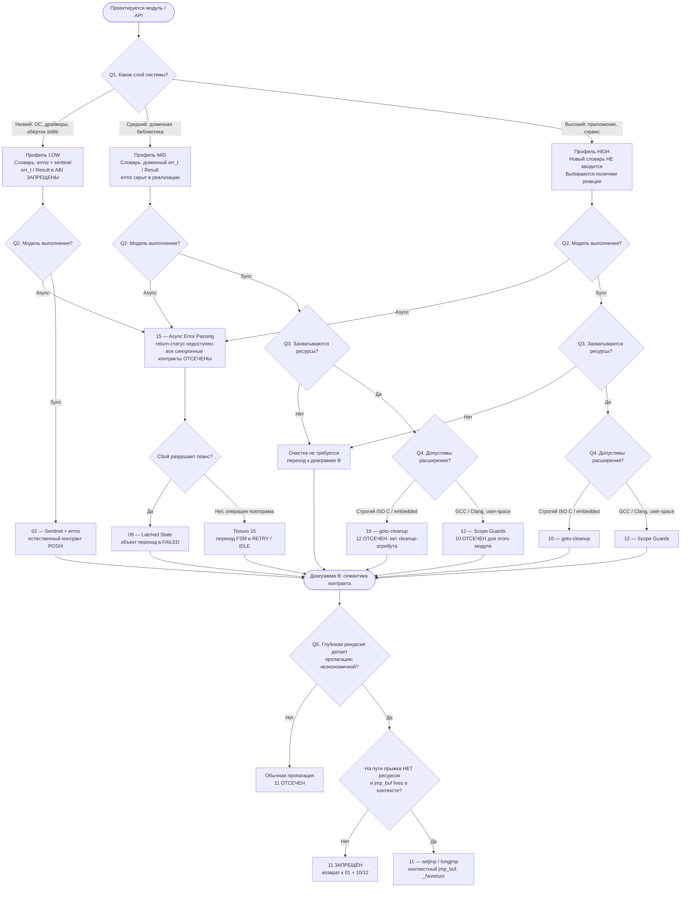
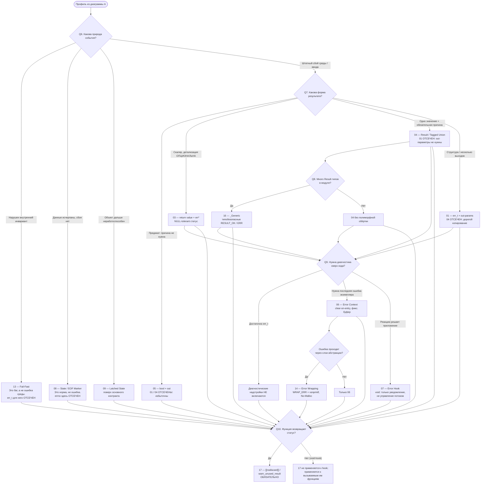

# Стратегия выбора паттернов обработки ошибок и алгоритм проектирования API

title: "Стратегия выбора паттернов обработки ошибок и алгоритм проектирования API"\
date: "2026-07-01"\
version: "v1.0"\
standards: "C11 (базовый); C23 (атрибуты); POSIX.1-2017; GCC/Clang Extensions"\
prerequisites:

- Изучен [Каталог паттернов обработки ошибок в C](00_pattern_catalog.md).
- Понимание различий между синхронным и асинхронным кодом.
- Понимание концепций владения ресурсами и времени жизни объектов.

objective:

- Предоставить систематический алгоритм выбора паттернов обработки ошибок для нового модуля или библиотеки.
- Описать «Архитектурные бандлы» — типовые комбинации паттернов для различных слоев системы.
- Визуализировать процесс принятия решений (Decision Tree).
- Определить границы совместимости паттернов и предостеречь от антипаттернов.

theory:\
  В языке C обработка ошибок — это не просто «возврат кода». Это **явное управление потоком выполнения, ресурсами и состоянием машины**.\
  Ошибка в C не может быть «брошена» и «поймана» неявно. Следовательно, стратегия обработки ошибок должна быть выбрана на этапе проектирования API и жестко зафиксирована. Смешивание паттернов внутри одного модуля (например, возврат `errno` в одних функциях и `err_t` в других) разрушает предсказуемость и ведет к уязвимостям.\
  Выбор стратегии опирается на три оси: **Слой системы** (где мы находимся?), **Модель выполнения** (как мы работаем?) и **Природа ошибки** (что случилось?).

---

## 1. Три оси классификации

### 1.1. Ось 1: Слой системы (Фильтр словаря)

Первый и самый жесткий фильтр. Он определяет, на каком «языке» функция будет разговаривать с окружением.

- **Низкий уровень (ОС / Драйверы / Обёртки stdlib):** Мы не можем выдумывать свои коды. Мы обязаны использовать `errno` и sentinel-значения (`NULL`, `-1`). Паттерны `err_t` или `Result` здесь отсекаются как нарушающие контракт POSIX.
- **Средний уровень (Доменные библиотеки / Фреймворки):** Мы скрываем `errno` и переводим ошибки на язык домена (`err_t` или `Result`). Использование `errno` в публичном API отсекается.
- **Высокий уровень (Приложения / Бизнес-логика):** Здесь мы не создаем новых кодов ошибок. Мы принимаем *политики* (retry, fallback, показ UI, завершение процесса).

#### 1.2. Ось 2: Модель выполнения (Фильтр механики)

Внутри каждой ветки мы задаем второй вопрос. Он работает как «рубильник», мгновенно отсекающий все синхронные паттерны, если среда асинхронна.

- **Асинхронность (`io_uring`, `epoll`, GUI event loop):** Стек вызовов разрушен. Возврат `err_t` или `Result` через `return` физически невозможен. **Все синхронные паттерны (01-12) отсекаются.** Единственный выбор — асинхронная передача через callback-и или очереди событий.
- **Синхронность:** Мы подтверждаем, что можем использовать стек вызовов, и переходим к Оси 3. (Здесь же, на этом шаге, учитываются ограничения компилятора: строгий ISO C диктует `goto-cleanup`, а GCC/Clang позволяют Scope Guards).

#### 1.3. Ось 3: Природа ошибки и данных (Фильтр семантики)

Этот шаг работает **только** для синхронных веток Среднего и Высокого слоев. Мы смотрим на то, *что именно* случилось.

- **Баг в коде (нарушен инвариант):** -> Паттерн 13 (Fail-Fast / `abort`).
- **Естественный конец данных (конец файла, пустая очередь):** -> Паттерн 08 (Маркеры состояния).
- **Фатальный сбой объекта (разорвало сокет, отвалилась БД):** -> Паттерн 09 (Latched State).
- **Штатная ошибка среды/ввода:** Выбираем форму возврата на основе данных:
  - Нужно вернуть одно число/строку? -> Паттерн 04 (Result).
  - Нужно вернуть сложную структуру? -> Паттерн 01 (`err_t` + out-параметры).
  - Это простой фильтр (да/нет)? -> Паттерн 05 (`bool`).

---

## 2. Алгоритм выбора: многоуровневая воронка принятия решений

### 2.1. Ролевая структура каталога

Прежде чем строить диаграмму, необходимо зафиксировать, **в каком измерении работает каждый паттерн**. Это устраняет ложную конкуренцию между ними.

| Роль | Паттерны | Характер выбора |
| :--- | :--- | :--- |
| **Контракт возврата** | [02](02_sentinel_errno.md), [01](01_return_code_out_params.md), [03](03_return_val_param_err_t.md), [04](04_result_struct.md), [05](05_bool_success.md), [08](08_state_stream_marker.md), [15](15_asyn_event_error_transfer.md) | **Эксклюзивный**: на одной границе API выбирается один основной способ возврата |
| **Маркер конца потока** | [08](08_state_stream_marker.md) | **Локальный**: заменяет контракт только для итеративных операций |
| **Состояние объекта** | [09](09_latched_error_state.md) | **Аддитивный**: поверх любого контракта для долгоживущих объектов |
| **Очистка ресурсов** | [10](10_goto_cleanup.md), [12](12_raii_emulation_with_scope_guard.md) | **Эксклюзивный внутри модуля**, но аддитивный к контракту |
| **Нелокальный выход** | [11](11_setjmp_longjmp.md) | **Исключение из правила**: только при доказанной неприменимости обычной пропагации |
| **Диагностика и делегирование** | [06](06_error_context.md), [14](14_error_context_wrapping.md), [07](07_error_callback.md) | **Аддитивный**: не меняет сигнатуру возврата |
| **Политика фатального сбоя** | [13](13_fail_fast_assert.md) | **Аддитивный**: для отдельного класса ошибок |
| **Эргономика типизации** | [16](16_type_safty_tagged_union.md) | **Аддитивный**: только над [04](04_result_struct.md) |
| **Принуждение** | [17](17_compiler_enforced_return_checking.md) | **Обязательный**: для любого непустого статуса |

**Следствие:** вопрос «какой паттерн выбрать?» некорректен. Корректен вопрос «какой **профиль** модуля собрать из пяти ролей?».

---

### 2.2. Диаграмма A — фильтр применимости (Слой → Модель → Ресурсы)

Эта диаграмма **не выбирает** контракт. Она отсекает то, что физически неприменимо, и формирует допустимое множество.

**Что здесь важно семантически:**

- Ветвь **LOW** никогда не попадает в выбор `Result`: контракт POSIX фиксирован средой, а не вкусом разработчика.
- Ветвь **Async** немедленно отсекает весь набор синхронных контрактов: вопрос о «форме возврата» просто перестаёт существовать.
- Вопрос о **ресурсах** — отдельный фильтр: если ресурсов нет, узлы 10/12 вообще не участвуют в профиле.
- Ветвь **11** — не равноправный вариант. Это *двухступенчатый допуск*: сначала доказана неэкономичность обычной пропагации, затем доказано отсутствие ресурсов на пути прыжка.

---

### 2.3. Диаграмма B — выбор контракта и аддитивных надстроек

Вход в эту диаграмму — профиль, выживший в фильтре A.

Здесь **сходимость стрелок к Q9/Q10 корректна**: это не отмена предыдущего выбора, а переход к *ортогональному* измерению. Выбор `01` или `04` уже сделан и сохраняется; вопрос диагностики на него не влияет.

---

### 2.4. Семантические условия включения всех 17 паттернов

Эта таблица — формальная спецификация к диаграммам. Она отвечает на вопрос «почему именно этот паттерн, а не соседний».

| № | Условие включения (истина ⇒ применим) | Что отсекает соседа | Роль |
| :-- | :-- | :-- | :-- |
| **01** | Нужен доменный статус **и** структура / несколько out-параметров | Отсекает 04: копирование крупного Result дороже | Контракт |
| **02** | Граница с POSIX/stdlib; тип имеет естественный sentinel | Отсекает 01/04: нарушает ожидаемое ABI | Контракт |
| **03** | Возвращается скаляр; детализация желательна, но не обязательна (`err` может быть `NULL`) | Отсекает 01: лишний out-параметр для `int` | Контракт |
| **04** | Возвращается одно значение **и** причина ошибки обязательна | Отсекает 03 и 05: у них статус можно потерять | Контракт |
| **05** | Это предикат / внутренний фильтр; причина не влияет на логику | Отсекает 01/04: избыточная диагностика | Контракт |
| **06** | Есть долгоживущий экземпляр и нужна строковая диагностика последней ошибки | Не конкурирует с 01: дополняет его | Диагностика |
| **07** | Политика реакции принадлежит приложению; нужен `void`-хук уведомления | Отсекает любые «callback с Retry/Abort»: это не управление потоком | Делегирование |
| **08** | Событие означает «больше нет данных», а не «не удалось» | Отсекает 02: `EOF` не является `errno` | Контракт потока |
| **09** | После сбоя объект не может корректно обслуживать операции | Отсекает «вернуть ошибку и продолжить»: это use-after-fail | Состояние |
| **10** | Есть ≥2 ресурса **и** строгий ISO C / отсутствие `cleanup` | Отсекает 12: расширение недоступно | Ресурсы |
| **11** | Рекурсия глубока **и** на пути прыжка нет ресурсов **и** `jmp_buf` в контексте | Отсекается сам при любом ресурсе на пути | Исключение |
| **12** | Есть ресурсы **и** GCC/Clang **и** модуль не использует `goto`/`longjmp` | Отсекает 10 для данного модуля: две модели очистки не смешиваются | Ресурсы |
| **13** | Нарушен инвариант либо среда необратимо неработоспособна | Отсекает 01/04: баг нельзя «вернуть как данные» | Политика |
| **14** | Ошибка проходит ≥2 слоя и требует добавления доменного контекста | Уточняет 06, а не заменяет его | Диагностика |
| **15** | Стек вызовов разрушен (event loop, completion queue) | Отсекает 01–12 как синхронные | Контракт |
| **16** | Уже выбран 04 **и** в модуле ≥3 Result-типа | Без 04 неприменим | Эргономика |
| **17** | Функция возвращает непустой статус | Обязателен поверх любого контракта | Принуждение |

---

### 2.5. Проверка алгоритма на трёх типовых профилях

#### Профиль 1. `config_load()` — доменная библиотека, строгий C11

`Средний` → `Sync` → `ресурсы есть` → `ISO C` ⇒ **10** → `штатный сбой, сложная структура` ⇒ **01** → `нужна диагностика + слои` ⇒ **06 + 14** → `статус возвращается` ⇒ **17**.

Итоговый бандл: **01 + 06 + 10 + 14 + 17**. Паттерны 04/16 отсечены формой данных; 12 — стандарт языка; 11 — наличием ресурсов.

#### Профиль 2. Парсер чисел — внутренняя логика

`Средний` → `Sync` → `ресурсов нет` ⇒ очистка не нужна → `одно значение + обязательная причина` ⇒ **04** → `много Result-типов` ⇒ **16** → **17**.

Итог: **04 + 16 + 17**. Паттерн 03 отсечён обязательностью причины; 05 — наличием диагностики; 06 — отсутствием долгоживущего состояния.

#### Профиль 3. `io_uring`-сервер

`Высокий` → `Async` ⇒ **15**, все синхронные контракты отсечены → `сбой разрушает сеанс` ⇒ **09** → `в callback найден NULL` ⇒ **13** (инвариант, не сетевая ошибка) → `диагностика привязана к запросу, не к общему ctx` ⇒ **06** в per-request области.

Итог: **06 + 09 + 13 + 15**, плюс **17** на синхронных служебных функциях движка. Паттерн 07 здесь **не** используется как механизм доставки: доставку выполняет 15, тогда как 07 — лишь необязательный `void`-хук телеметрии.

---

## 3. Архитектурные Бандлы и Матрица Комбинаций

Паттерны редко используются по одному. В индустрии сложились устойчивые связки — «бандлы». Однако жестко фиксировать только 3-4 бандла было бы ошибкой: пространство возможных комбинаций гораздо шире.

Чтобы охватить все возможные сочетания, мы используем метод **Матрицы Ролей**. Мы разделяем паттерны на ортогональные «роли» (измерения), где выбор в одной роли не отменяет выбор в другой, а формирует итоговый профиль модуля.

### 3.1. Матрица Ролей (Конструктор профиля)

Эта таблица задает **пространство всех допустимых комбинаций**. Архитектор проходит по каждой строке и выбирает *один* вариант, соответствующий ограничениям среды (диаграмма из Раздела 2).

| Роль (Измерение) | Вариант А | Вариант Б | Вариант В | Вариант Г |
| :--- | :--- | :--- | :--- | :--- |
| **1. Контракт возврата** *(Эксклюзивно)* | **02**: Sentinel + `errno` *(Низкий слой)* | **01**: `err_t` + out-параметры | **04**: Result / Tagged Union | **05**: `bool` *(внутренние фильтры)* |
| **2. Очистка ресурсов** *(Эксклюзивно)* | **10**: `goto-cleanup` *(Строгий ISO C)* | **12**: Scope Guards *(GCC/Clang)* | *Нет ресурсов* | *Нелокальный выход:* **11** `setjmp` *(только если нет ресурсов)* |
| **3. Диагностика** *(Аддитивно)* | *Только код ошибки* | **06**: Контекст (`lib_ctx_t`) | **06 + 14**: Контекст + Wrapping | **07**: Callback-хук *(уведомления)* |
| **4. Состояние объекта** *(Аддитивно)* | *Обычный объект* | **09**: Latched State *(залипание при фатальном сбое)* | | |
| **5. Фатальные сбои** *(Аддитивно)* | *Возврат кода ошибки* | **13**: Fail-Fast / `abort` *(падение при нарушении инвариантов)* | | |
| **6. Эргономика** *(Только для 04)* | *Явное указание типов* | **16**: `_Generic` *(полиморфные макросы)* | | |
| **7. Принуждение** *(Обязательно)* | **17**: `[[nodiscard]]` / `warn_unused_result` *(применяется ко всем функциям, возвращающим статус)* | | | |

**Математика пространства:** Если перемножить варианты для синхронного среднего слоя, мы получим десятки теоретических профилей. Но **95% из них будут семантически противоречивы** (например, `bool` + `Wrapping` избыточны, а `goto` + `Scope Guards` взаимоисключающи). Индустрия отобрала из этого пространства **7 канонических бандлов**.

### 3.2. Семь Канонических Бандлов

Ниже приведены 7 типовых комбинаций, которые покрывают все 17 паттернов каталога. Каждая строка — это готовый «рецепт» для конкретного архитектурного слоя.

| Бандл | Целевой слой / Задача | Контракт | Ресурсы | Диагностика | Состояние | Фатальность | Эргономика | Принуждение |
| :--- | :--- | :--- | :--- | :--- | :--- | :--- | :--- | :--- |
| **A. POSIX-обёртка** | Низкий (ОС/Драйверы) | **02** | **10** | *Код* | *Обычный* | *Возврат* | *N/A* | **17** |
| **B. Доменная библиотека** | Средний (Core API) | **01** | **10** | **06 + 14** | *Обычный* | *Возврат* | *N/A* | **17** |
| **C. Функциональный парсер** | Средний (Внутренняя логика) | **04** | *Нет* | *Код* | *Обычный* | *Возврат* | **16** | **17** |
| **D. Async-сервер** | Высокий (Event Loop) | **15** | *Нет* | *В статусе* | **09** | **13** | *N/A* | **17** |
| **E. Внутренний хелпер** | Любой (Фильтры/Предикаты) | **05** | *Нет* | *Нет* | *Обычный* | *Возврат* | *N/A* | **17** |
| **F. Глубокий рекурсивный парсер** | Средний (AST, DSL) | **01** | **11** | *Код* | *Обычный* | **13** | *N/A* | **17** |
| **G. Современный Linux-демон** | Средний/Высокий (User-space) | **01** | **12** | **06** | *Обычный* | *Возврат* | *N/A* | **17** |

*(Примечание: Паттерн **08** (Маркеры) не вынесен в отдельный бандл, так как он является локальным паттерном для итераторов и потоков чтения, обычно встраиваясь внутрь Бандлов A, B или G. Паттерн **03** является частным случаем между 01 и 04, когда детализация опциональна).*

### 3.3. Детальное описание новых бандлов

**Бандл A: «Классическая POSIX-обёртка» (Низкий уровень)**
*Задача:* Написать `my_read_file()`, которая читает файл и возвращает буфер.

- **Паттерн 02 (Sentinel + errno):** Возвращаем `char *` или `-1`, детали через `errno`.
- **Паттерн 10 (Goto-cleanup):** Для освобождения промежуточных буферов и закрытия `fd`.
- **Паттерн 17 (Enforcement):** `__attribute__((warn_unused_result))`.
- *Почему это работает:* Максимально близко к ядру ОС, нулевой overhead, привычно для системных программистов.

**Бандл B: «Доменная библиотека среднего уровня» (Core Library)**
*Задача:* Написать `config_load()`, которая парсит JSON/INI и возвращает структуру.

- **Паттерн 01 (err_t + out-параметры):** Возвращаем `err_t`, данные пишем в `config_t **out`.
- **Паттерн 06 (Контекст ошибок):** Внутри `lib_ctx_t` храним строку последней ошибки.
- **Паттерн 14 (Error Wrapping):** Макрос `WRAP_ERR` для обогащения контекста при пробросе наверх.
- **Паттерн 10 (Goto-cleanup):** Для управления ресурсами внутри `config_load`.
- **Паттерн 17 (Enforcement):** `[[nodiscard]]` на всех функциях API.
- *Почему это работает:* Скрывает `errno` от пользователя, дает богатую диагностику, обеспечивает строгий ABI.

**Бандл C: «Современный функциональный парсер» (Внутренняя логика)**
*Задача:* Написать парсер строк в числа/даты.

- **Паттерн 04 (Result / Tagged Union):** Возвращаем `result_int_t`.
- **Паттерн 16 (_Generic):** Используем макросы `RESULT_OK(val)` для полиморфизма.
- **Паттерн 17 (Enforcement):** `[[nodiscard]]` на самом типе `result_int_t` (фича C23).
- *Почему это работает:* Код читается как на Rust/Haskell, невозможна потеря ошибки, нет out-параметров.

**Бандл D: «Высоконагруженный Async-сервер» (Event Loop)**
*Задача:* Обработать 100к соединений через `io_uring`.

- **Паттерн 15 (Async Passing):** Ошибки приходят в `completion_cb` как `status < 0`.
- **Паттерн 09 (Latched State):** Если сокет вернул `-EPIPE`, переводим `conn_t` в `FAILED`, все следующие сабмиты сразу отклоняем.
- **Паттерн 13 (Fail-Fast):** Если в callback обнаружился `NULL` (баг логики) — вызываем `abort()`, чтобы сохранить Core Dump.
- *Почему это работает:* Соответствует модели конечных автоматов, защищает от Use-After-Free при таймаутах.

**Бандл E: «Внутренний хелпер / Фильтр» (Утилитарный)**
*Задача:* Проверить, является ли строка валидным IP-адресом.

- **Паттерн 05 (bool + out):** Возвращаем `true/false`, данные пишем в `struct in_addr *out`.
- **Паттерн 17 (Enforcement):** `[[nodiscard]]`.
- *Почему это работает:* Причина неуспеха не важна для логики (просто идем дальше), детализация через `err_t` была бы избыточна.

**Бандл F: «Глубокий рекурсивный парсер» (DSL / Компиляторы)**
*Задача:* Парсер с 20 уровнями вложенности, где на 18-м уровне найдена синтаксическая ошибка.

- **Паттерн 01 (err_t):** Базовый контракт.
- **Паттерн 11 (setjmp/longjmp):** Используем *контекстный* `jmp_buf` (как в `libpng`), чтобы мгновенно откатиться наверх без засорения кода `return err` на каждом уровне.
- **Паттерн 13 (Fail-Fast):** Если нарушен инвариант AST — `abort()`.
- *Почему это работает:* Единственный способ избежать "ада" из 20 уровней `if (err != OK) return err;`. **Важно:** между `setjmp` и `longjmp` *запрещено* захватывать ресурсы (иначе утечки).

**Бандл G: «Современный Linux-демон» (User-space)**
*Задача:* Написать CLI-утилиту или сетевой агент для Linux (GCC/Clang).

- **Паттерн 01 (err_t):** Базовый контракт.
- **Паттерн 12 (Scope Guards):** Используем `__attribute__((cleanup))` вместо `goto`. Код становится линейным, утечки при ранних `return` физически невозможны.
- **Паттерн 06 (Контекст):** Для логирования.
- **Паттерн 17 (Enforcement):** `[[nodiscard]]`.
- *Почему это работает:* Эргономика C++ (RAII) на чистом C, при этом сохраняется строгий доменный контракт `err_t`.

---

## 4. Матрица совместимости и конфликты

Паттерны не существуют изолированно. Они формируют **профиль модуля**, состоящий из нескольких ролей. Не все роли можно смешивать произвольно: некоторые усиливают друг друга (синергия), некоторые требуют дисциплины (осторожно), а некоторые категорически несовместимы (конфликт).

### 4.1. Матрица совместимости ролей (7×7)

Эта таблица показывает, как взаимодействуют **роли** (измерения) из Раздела 3. Каждая ячейка указывает характер взаимодействия между выбором в одной роли и выбором в другой.

**Легенда:**

- ✅ **Синергия** — паттерны усиливают друг друга, рекомендуются вместе
- ⚠️ **Осторожно** — допустимы вместе, но требуют дисциплины и документирования
- 🚫 **Конфликт** — нельзя смешивать в одном модуле/слое
- **—** **Ортогональны** — не пересекаются, выбор в одной роли не влияет на другую

| Роль ↓ / Роль → | 1. Контракт | 2. Очистка | 3. Диагностика | 4. Состояние | 5. Фатальность | 6. Эргономика | 7. Принуждение |
| :--- | :---: | :---: | :---: | :---: | :---: | :---: | :---: |
| **1. Контракт возврата** | — | ⚠️ | ✅ | ✅ | ⚠️ | ⚠️ | ✅ |
| **2. Очистка ресурсов** | ⚠️ | — | ⚠️ | ⚠️ | 🚫 | — | ⚠️ |
| **3. Диагностика** | ✅ | ⚠️ | — | ✅ | ⚠️ | — | ✅ |
| **4. Состояние объекта** | ✅ | ⚠️ | ✅ | — | ✅ | — | ✅ |
| **5. Фатальные сбои** | ⚠️ | 🚫 | ⚠️ | ✅ | — | — | — |
| **6. Эргономика** | ⚠️ | — | — | — | — | — | ✅ |
| **7. Принуждение** | ✅ | ⚠️ | ✅ | ✅ | — | ✅ | — |

**Ключевые выводы из матрицы:**

- **Роль 2 (Очистка) и Роль 5 (Фатальность)** — **конфликт**. Если вы используете `setjmp/longjmp` (Паттерн 11), вы не можете захватывать ресурсы между `setjmp` и `longjmp`. Это катастрофа.
- **Роль 1 (Контракт) и Роль 7 (Принуждение)** — **синергия**. Любой контракт возврата (01, 02, 04, 05) обязан сопровождаться `[[nodiscard]]` (Паттерн 17).
- **Роль 3 (Диагностика) и Роль 1 (Контракт)** — **синергия**. Контекст ошибок (06) и обогащение (14) идеально дополняют `err_t` (01) или `Result` (04).

### 4.2. Детальные правила сочетаемости

Для конкретных пар паттернов, которые вызывают вопросы, приведем детальные таблицы.

#### Таблица 1. Сочетаемость контрактов возврата (Роль 1)

| Паттерн | 01 (err_t) | 02 (errno) | 03 (return+err) | 04 (Result) | 05 (bool) | 08 (EOF) | 15 (Async) |
| :--- | :---: | :---: | :---: | :---: | :---: | :---: | :---: |
| **01 (err_t)** | — | 🚫 | ⚠️ | 🚫 | ⚠️ | ⚠️ | 🚫 |
| **02 (errno)** | 🚫 | — | 🚫 | 🚫 | 🚫 | ⚠️ | 🚫 |
| **03 (return+err)** | ⚠️ | 🚫 | — | 🚫 | ⚠️ | ⚠️ | 🚫 |
| **04 (Result)** | 🚫 | 🚫 | 🚫 | — | 🚫 | ⚠️ | 🚫 |
| **05 (bool)** | ⚠️ | 🚫 | ⚠️ | 🚫 | — | ⚠️ | 🚫 |
| **08 (EOF)** | ⚠️ | ⚠️ | ⚠️ | ⚠️ | ⚠️ | — | ⚠️ |
| **15 (Async)** | 🚫 | 🚫 | 🚫 | 🚫 | 🚫 | ⚠️ | — |

**Правила:**

- **🚫 Нельзя смешивать** два разных контракта в одном модуле. Если вы выбрали `err_t` (01), не возвращайте `errno` (02) или `Result` (04) из других функций того же API.
- **⚠️ Паттерн 08 (EOF)** — ортогонален другим контрактам. Он используется для итераторов и потоков чтения, обычно внутри функций, которые уже используют 01, 02 или 04.
- **🚫 Паттерн 15 (Async)** — полностью изолирован. Если вы в асинхронном коде, все синхронные контракты (01-05) отсечены.

#### Таблица 2. Сочетаемость очистки ресурсов (Роль 2)

| Паттерн | 10 (goto) | 11 (setjmp) | 12 (Scope Guards) |
| :--- | :---: | :---: | :---: |
| **10 (goto)** | — | 🚫 | 🚫 |
| **11 (setjmp)** | 🚫 | — | 🚫 |
| **12 (Scope Guards)** | 🚫 | 🚫 | — |

**Правила:**

- **🚫 Все три паттерна взаимоисключающи** в пределах одного модуля. Вы должны выбрать **один** механизм очистки и придерживаться его.
- **10 (goto)** — строгий ISO C, переносим везде.
- **11 (setjmp)** — только если нет ресурсов на пути прыжка.
- **12 (Scope Guards)** — только для GCC/Clang, не для кроссплатформы.

#### Таблица 3. Сочетаемость диагностики (Роль 3)

| Паттерн | 06 (Контекст) | 07 (Callback) | 14 (Wrapping) |
| :--- | :---: | :---: | :---: |
| **06 (Контекст)** | — | ⚠️ | ✅ |
| **07 (Callback)** | ⚠️ | — | ⚠️ |
| **14 (Wrapping)** | ✅ | ⚠️ | — |

**Правила:**

- **✅ 06 + 14** — идеальная синергия. Контекст (06) хранит состояние, а макросы `WRAP_ERR` (14) обогащают его при пробросе через слои.
- **⚠️ 07 (Callback)** — требует осторожности. Callback не должен вызывать функции той же библиотеки (риск deadlock). Если вы используете callback (07), документируйте ограничения реентерабельности.

### 4.3. Запрещенные комбинации (Антипаттерны)

Эти комбинации **категорически запрещены** и ведут к катастрофам:

| Комбинация | Вердикт | Обоснование |
| :--- | :---: | :--- |
| **11 (setjmp) + захват ресурсов** | 🚫 **КАТАСТРОФА** | `longjmp` не вызывает деструкторы и не выполняет `goto cleanup`. Использование `setjmp` в коде, захватывающем ресурсы, гарантированно приведет к утечкам памяти и дескрипторов. |
| **10 (goto) + 12 (Scope Guards)** | 🚫 **Конфликт** | Нельзя использовать `goto` для прыжков в коде, где переменные имеют атрибут `cleanup`. Это приводит к неопределенному поведению или двойному освобождению. Выбирайте что-то одно на модуль. |
| **07 (Callback) + управление потоком** | 🚫 **АНТИПАТТЕРН** | Callback (Паттерн 07) должен возвращать `void`. Попытка вернуть из callback `enum` (Retry/Abort) ломает синхронную модель C и ведет к рекурсии/deadlock-ам. |
| **02 (errno) в публичном API библиотеки** | 🚫 **Нарушение контракта** | `errno` — это контракт низкого уровня (POSIX). Библиотека среднего уровня обязана скрывать `errno` и переводить его в доменный `err_t` (01) или `Result` (04). |
| **Смешение 01 (err_t) и 04 (Result) в одном API** | 🚫 **Нарушение предсказуемости** | Если в одной библиотеке одни функции возвращают `err_t`, а другие — `Result`, это разрушает предсказуемость API. Выберите один основной контракт на модуль. |
| **13 (Fail-Fast) для ошибок среды** | 🚫 **Ложная семантика** | `assert` и `abort` — для ошибок инвариантов (багов). Для ошибок среды (нет файла, нет памяти) используйте возврат кода ошибки (01, 02, 04). |

### 4.4. Рекомендуемые синергии (Бандлы)

Эти комбинации **рекомендуются** и образуют устойчивые профили:

| Комбинация | Вердикт | Обоснование |
| :--- | :---: | :--- |
| **01 (err_t) + 17 (nodiscard)** | ✅ **Обязательно** | `err_t` без принудительной проверки компилятором бессмысленна, так как разработчик может её проигнорировать. |
| **01 (err_t) + 06 (Контекст) + 14 (Wrapping)** | ✅ **Классика** | `err_t` для управления потоком, контекст для диагностики, макросы для обогащения. Это Бандл B из Раздела 3. |
| **04 (Result) + 16 (_Generic) + 17 (nodiscard)** | ✅ **Функциональный стиль** | `Result` для упаковки, `_Generic` для полиморфизма, `nodiscard` для защиты от потери. Это Бандл C. |
| **02 (errno) + 10 (goto)** | ✅ **POSIX-обертка** | `errno` для деталей, `goto cleanup` для ресурсов. Это Бандл A. |
| **15 (Async) + 09 (Latched State) + 13 (Fail-Fast)** | ✅ **Async-сервер** | `Async` для доставки ошибок, `Latched` для мертвых сокетов, `Fail-Fast` для багов в callback. Это Бандл D. |
| **06 (Контекст) + 09 (Latched State)** | ✅ **Долгоживущий объект** | Контекст хранит состояние, `Latched` переводит объект в `FAILED` при фатальном сбое. |
| **01 (err_t) + 10 (goto) + 17 (nodiscard)** | ✅ **Базовый профиль** | Минимальный набор для библиотеки среднего уровня: контракт, очистка, принуждение. |

---

## 5. Сквозные практики и инварианты безопасности (Cross-Cutting Concerns)

Эти правила применяются ко всем паттернам и слоям системы, независимо от выбранного бандла. Их нарушение ведет к уязвимостям, утечкам или неопределенному поведению (UB).

### 5.1. Инварианты состояния и памяти

1. **Детерминизм инициализации.** Out-параметры и буферы **обязаны** быть обнулены в первой строке функции (`memset`, `= NULL`, `= 0`). Ресурсы, захватываемые для `goto-cleanup` (Паттерн 10) или Scope Guards (Паттерн 12), **обязаны** инициализироваться безопасными sentinel-значениями (`-1` для `fd`, `NULL` для указателей). Никакого мусора из стека.
2. **Правило No-Malloc в путях ошибок.** Если система упала с `ERR_NO_MEM` или `ENOMEM`, вы не можете вызвать `malloc` / `strdup`, чтобы сформировать строку ошибки или обогатить контекст (Паттерн 14). Используйте только стековые буферы фиксированного размера и `snprintf` / `vsnprintf`.
3. **Disarm Pattern (Обезвреживание при передаче владения).** Если функция завершается успешно и передает владение ресурсом вызывающему коду (через out-параметр или `Result`), локальный указатель **обязан** быть обнулен до выхода из области видимости. Иначе `cleanup`-блок или Scope Guard освободит чужой ресурс (`double-free`).

### 5.2. Инварианты семантики и потока

1. **Разделение EOF и Ошибки.** Никогда не используйте одно и то же значение (например, `NULL` или `-1`) и для естественного конца данных (Паттерн 08), и для ошибки среды (Паттерн 02). При чтении потоков всегда проверяйте `ferror()` после выхода из цикла по `EOF`. Если типы совпадают — используйте Tagged Union (Паттерн 04).
2. **Запрет на управление потоком через Callback.** Callback-обработчик (Паттерн 07) **обязан** возвращать `void`. Попытка вернуть из callback `enum` (Retry/Abort) ломает синхронную модель C, ведет к рекурсии и deadlock-ам.
3. **Clear-on-Entry для контекстов.** Если вы используете контекст ошибок (Паттерн 06), каждая публичная функция обязана начинать выполнение с вызова `clear_error(ctx)`. Это предотвращает чтение «устаревших» ошибок от предыдущих успешных вызовов.

### 5.3. Инварианты многопоточности и асинхронности

1. **Атомарность для Latched State.** Если объект может «умереть» (Паттерн 09) и используется в многопоточной среде, флаг смерти (`failed`) обязан быть объявлен как `_Atomic` (C11), а его изменение — производиться через `atomic_compare_exchange_strong`.
2. **Контракты времени жизни (Lifetime) в Async.** В асинхронных моделях (Паттерн 15) контекст запроса (`io_req_t`) **обязан** жить до момента вызова `completion_cb`. Освобождение памяти до вызова callback — это гарантированный Use-After-Free и Segmentation Fault.
3. **Потокобезопасность `strerror`.** В многопоточном коде категорически запрещено использовать стандартную `strerror(errno)`. Применяйте только `strerror_r` (POSIX) или копируйте результат в локальный буфер немедленно.

---

### 6. Практические рекомендации для Архитектора (Checklist)

Этот чек-лист должен использоваться при проектировании нового модуля, библиотеки или при проведении архитектурного ревью.

### 6.1. Проектирование API и контрактов

1. **Фиксация стратегии (Один бандл на модуль).** Не позволяйте разработчикам выбирать паттерны «по настроению». Если вы выбрали Бандл B (`err_t` + `lib_ctx_t`) для сетевой библиотеки — все функции модуля должны подчиняться этому контракту. Смешение `errno` и `err_t` в одном API разрушает предсказуемость.
2. **Маппинг ошибок (Скрытие деталей ОС).** На среднем уровне (библиотеки) `errno` и POSIX-коды **не должны** «торчать» наружу. Используйте внутренний маппинг `errno` -> доменный `err_t` (Паттерн 01) или `Result` (Паттерн 04), чтобы обеспечить стабильный ABI и кроссплатформенность.
3. **Документирование владения (Ownership).** Для каждой функции, возвращающей указатель или принимающей его, явно документируйте: кто выделяет память, кто освобождает, и что происходит с указателем при ошибке (гарантирован ли `NULL`?).

### 6.2. Эргономика и защита от ошибок

1. **Используйте макросы-адаптеры.** Создайте общие заголовки (например, `result_macros.h`, `cleanup_guards.h`, `error_macros.h`), чтобы внедрение Паттернов 12 (Scope Guards), 14 (Wrapping) и 16 (`_Generic`) было делом одной строки кода. Это снизит когнитивную нагрузку и количество опечаток.
2. **Требуйте `[[nodiscard]]` на Code Review.** Если функция возвращает статус (`err_t`, `bool`, `Result`), но не помечена атрибутом Паттерна 17 — это повод **отклонить Pull Request**. Игнорирование статуса в C — это тихая порча данных.
3. **Применяйте `[[nodiscard]]` к типам (C23).** Если вы пишете на C23, помечайте атрибутом сами структуры `Result`. Это избавит от необходимости повторять атрибут для каждой функции-парсера.

### 6.3. Отладка, тестирование и эксплуатация

1. **Тесты на инъекцию ошибок (Fault Injection).** Поскольку в C нет скрытого потока управления, вы должны искусственно провоцировать `malloc` на возврат `NULL` (через mock-аллокатор) или `fopen` на ошибку. Это единственный способ проверить, что ваш `goto-cleanup` (Паттерн 10) или Scope Guards (Паттерн 12) корректно освобождают ресурсы при сбоях.
2. **Настройка Core Dumps для Fail-Fast.** Принцип Fail-Fast (Паттерн 13) имеет смысл только тогда, когда вы можете проанализировать падение. Убедитесь, что в вашей ОС и окружении (Docker, systemd) настроено сохранение core-дампов (`ulimit -c unlimited`, `kernel.core_pattern`).
3. **Интеграция статического анализа.** Используйте инструменты (Coverity, clang-tidy, Polyspace) для автоматической проверки правил MISRA C (Rule 17.7 — проверка return-значений) и CERT C (разделы ERR и MEM). Атрибуты `warn_unused_result` и `[[nodiscard]]` должны поддерживаться вашим статическим анализатором.
4. **Логирование состояний для Async.** В асинхронных серверах (Паттерн 15) стек вызовов в момент ошибки бесполезен. Внедрите макрос `REQ_LOG(req, "Transition to FAILED: %d", status)`, который будет писать ID запроса и его FSM-переходы. Это единственный способ отлаживать event-loop код.

---

### References

**Внутренние документы репозитория:**

**Внутренние документы репозитория:**

- [00_pattern_catalog.md](00_pattern_catalog.md) — Полная таксономия из 17 паттернов.
- [01_return_code_out_params.md](01_return_code_out_params.md) — Базовый паттерн для библиотек.
- [02_sentinel_errno.md](02_sentinel_errno.md) — Взаимодействие с POSIX.
- [03_return_val_param_err_t.md](03_return_val_param_err_t.md) — Возврат скаляра с опциональной детализацией.
- [04_result_struct.md](04_result_struct.md) — Функциональный стиль (Result / Tagged Union).
- [05_bool_success.md](05_bool_success.md) — Простые предикаты и фильтры.
- [06_error_context.md](06_error_context.md) — Хранение состояния ошибок.
- [07_error_callback.md](07_error_callback.md) — Делегирование политики уведомления (Hooks).
- [08_state_stream_marker.md](08_state_stream_marker.md) — Разделение нормы (EOF) и сбоя.
- [09_latched_error_state.md](09_latched_error_state.md) — Защита от каскадных сбоев (Circuit Breaker).
- [10_goto_cleanup.md](10_goto_cleanup.md) — Основа управления ресурсами (ISO C).
- [11_setjmp_longjmp.md](11_setjmp_longjmp.md) — Узкоспециализированные не-локальные переходы.
- [12_raii_emulation_with_scope_guard.md](12_raii_emulation_with_scope_guard.md) — Эргономика очистки (GCC/Clang).
- [13_fail_fast_assert.md](13_fail_fast_assert.md) — Философия необратимых сбоев.
- [14_error_context_wrapping.md](14_error_context_wrapping.md) — Обогащение диагностики при пробросе.
- [15_asyn_event_error_transfer.md](15_asyn_event_error_transfer.md) — Асинхронные модели и FSM.
- [16_type_safty_tagged_union.md](16_type_safty_tagged_union.md) — Полиморфизм через `_Generic`.
- [17_compiler_enforced_return_checking.md](17_compiler_enforced_return_checking.md) — Механизмы статического принуждения.

**Внешние стандарты и литература:**

- **SEI CERT C Coding Standard:** Разделы ERR (Ошибки) и MEM (Управление памятью).
- **Linux Kernel Coding Style:** Раздел 4 (Обоснование `goto` и кодов ошибок).
- **John Regehr, "A Guide to Undefined Behavior in C and C++":** Понимание того, почему ошибки инвариантов нельзя «лечить».
- **Martin Fowler, "Fail Fast":** Архитектурные принципы раннего обнаружения ошибок.

## Changelog

  v1.0 — initial.
